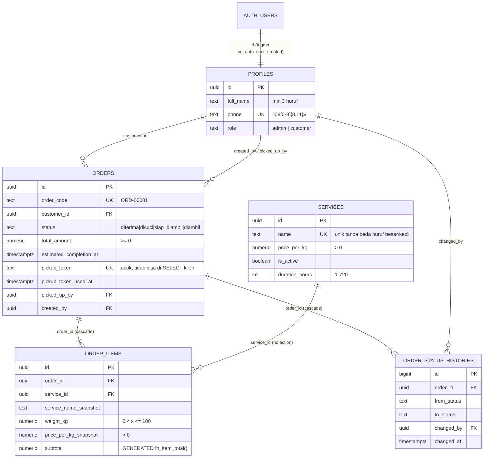

# Database YALT (PostgreSQL di Supabase)

Dokumen ini berisi bukti setiap fitur database: tabel, relasi, constraint, index, RLS, fungsi/RPC, trigger, view, transaksi, row locking, serta backup/restore. Semua objek SQL dikelola sebagai *migration* di `supabase/migrations/` dan diuji dengan `supabase/tests/order_flow_test.sql`.

| File | Isi |
|---|---|
| `supabase/migrations/20261103000000_create_services.sql` | Tabel `services`, trigger `set_updated_at`, RLS baca publik |
| `supabase/migrations/20261103010000_create_profiles_and_service_admin_policies.sql` | Tabel `profiles`, trigger `on_auth_user_created`, `is_admin()`, RLS admin untuk `services` |
| `supabase/migrations/20261107000000_create_orders.sql` | `orders`, `order_items`, `order_status_histories`, `fn_item_total`, trigger status, RLS, RPC pesanan & QR, view, Realtime |
| `supabase/migrations/20261107010000_customer_management_and_service_delete.sql` | `customer_summary_view`, RPC kelola pelanggan, RPC hapus layanan |
| `supabase/migrations/20261107020000_security_hardening.sql` | Perbaikan temuan Security Advisor (search_path, hak EXECUTE) |
| `supabase/seed.sql` | 4 layanan (+ estimasi jam) dan 3 akun demo |
| `supabase/tests/order_flow_test.sql` | 35 tes SQL, semua data tes otomatis di-rollback |

---

## 1. ERD



## 2. Tabel, constraint, dan index

| Tabel | Constraint penting | Index |
|---|---|---|
| `profiles` | FK ke `auth.users` (cascade), `phone` unik + regex, `role` check | `profiles_role_idx` |
| `services` | `price_per_kg > 0`, `duration_hours 1-720`, nama unik (case-insensitive) | `services_name_unique_idx (lower(name))`, `services_is_active_idx` |
| `orders` | status check, `total_amount >= 0`, `order_code` & `pickup_token` unik, **`(status = 'diambil') = (pickup_token_used_at is not null)`** | `orders_customer_created_idx (customer_id, created_at desc)`, partial `orders_active_created_idx where status <> 'diambil'` |
| `order_items` | `weight_kg` 0–100, harga > 0, FK `service_id` tanpa cascade (layanan terpakai tidak bisa dihapus) | `order_items_order_id_idx`, `order_items_service_id_idx` |
| `order_status_histories` | `to_status` check | `order_status_histories_order_idx (order_id, changed_at)` |

- Uang & berat memakai `NUMERIC`, bukan `double`, agar tidak ada error pembulatan.
- **Snapshot harga**: `order_items.price_per_kg_snapshot` dan `service_name_snapshot` disalin saat pesanan dibuat, sehingga perubahan tarif tidak mengubah pesanan lama.
- `order_items.subtotal` adalah *generated column* `fn_item_total(weight_kg, price_per_kg_snapshot)`, jadi subtotal tidak bisa dimanipulasi klien.

## 3. Row Level Security & hak akses

| Objek | Siapa boleh apa |
|---|---|
| `services` | Semua orang boleh membaca. Tambah/ubah/hapus hanya admin (`is_admin()`). |
| `profiles` | Pengguna membaca profilnya sendiri, admin membaca semua. |
| `orders` | SELECT: `customer_id = auth.uid()` atau admin. **Tidak ada** INSERT/UPDATE/DELETE untuk klien (privilege dicabut). |
| `order_items`, `order_status_histories` | SELECT mengikuti hak akses pesanan induknya. |
| Kolom `orders.pickup_token` | Tidak di-GRANT ke `authenticated` (hak per kolom). `select=*` ditolak, jadi selalu pilih kolom secara eksplisit. Pelanggan mengambil tokennya lewat `sp_get_pickup_token`. |
| View | Semua view memakai `security_invoker = true`, sehingga RLS tabel asal tetap berlaku. |
| RPC | `EXECUTE` dicabut dari `public`/`anon` dan diberikan ke `authenticated`. Pengecekan role ada di dalam fungsi. |

Kode error yang dipakai fungsi (dipetakan PostgREST ke HTTP):

| SQLSTATE | HTTP | Arti |
|---|---|---|
| `42501` | 403 (401 tanpa login) | Tidak berhak |
| `22023` | 400 | Input tidak valid |
| `23505` | 409 | Data ganda (nomor HP) |
| `23503` | 409 | Masih direferensikan (FK) |
| `PT404` | 404 | Data / QR tidak ditemukan |
| `PT409` | 409 | Transisi status tidak valid, QR sudah dipakai, belum siap |

Setiap error membawa `hint` yang bisa dibaca mesin, misalnya `invalid_transition`, `pickup_requires_qr`, `token_used`, `not_ready`, `token_not_found`, `phone_taken`, `customer_has_orders`, dan `invalid_weight`.

## 4. Fungsi (RPC)

| Fungsi | Endpoint | Keterangan |
|---|---|---|
| `fn_item_total(weight, price)` | `POST /rest/v1/rpc/fn_item_total` | `round(weight * price, 0)`. Dipakai di generated column dan saat menghitung total pesanan. |
| `sp_create_order(customer_id, items jsonb, notes)` | `POST /rest/v1/rpc/sp_create_order` | Admin saja. Memvalidasi pelanggan, 1–20 item, berat 0–100 kg, dan layanan aktif (dikunci `FOR SHARE`). Menyimpan snapshot tarif, menghitung total & estimasi selesai. **Atomik.** |
| `sp_update_order_status(order_id, new_status)` | `POST /rest/v1/rpc/sp_update_order_status` | Admin saja. Mengunci baris (`FOR UPDATE`) dan hanya mengizinkan maju satu langkah. Status `diambil` ditolak (`pickup_requires_qr`). |
| `sp_get_pickup_token(order_id)` | `POST /rest/v1/rpc/sp_get_pickup_token` | Hanya pemilik pesanan. Token bernilai `null` setelah dipakai. |
| `sp_pickup_order(token)` | `POST /rest/v1/rpc/sp_pickup_order` | Admin saja. `SELECT … FOR UPDATE` berdasarkan token, cek belum dipakai & `siap_diambil`, lalu set `diambil` + `pickup_token_used_at` dalam satu transaksi. |
| `sp_delete_service(service_id)` | `POST /rest/v1/rpc/sp_delete_service` | Admin saja. Jika sudah dipakai pesanan → `is_active = false` (`deactivated`), jika belum → dihapus (`deleted`). |
| `admin_create_customer(name, phone, password)` | `POST /rest/v1/rpc/admin_create_customer` | Admin saja. Membuat akun di `auth.users` + `auth.identities`; profil dibuat trigger. Password awal **wajib** diisi admin (min. 6 karakter tanpa spasi, tanpa nilai default sejak migrasi `20261118000000`). |
| `admin_update_customer(id, name, phone)` | `POST /rest/v1/rpc/admin_update_customer` | Admin saja. Mengubah profil & email login (`<hp>@yalt.test`). |
| `admin_delete_customer(id)` | `POST /rest/v1/rpc/admin_delete_customer` | Admin saja. Ditolak jika pelanggan punya pesanan (`customer_has_orders`). |

## 5. Trigger

| Trigger | Tabel | Fungsi |
|---|---|---|
| `orders_validate_status` | `orders` BEFORE INSERT/UPDATE | Pesanan baru wajib `diterima`. Perubahan status hanya maju satu langkah. `diambil` wajib disertai `pickup_token_used_at`. Berlaku juga untuk update langsung dari dashboard. |
| `orders_log_status` | `orders` AFTER INSERT/UPDATE | Mencatat `from_status → to_status`, `changed_by = auth.uid()`, dan waktu ke `order_status_histories`. |
| `orders_set_updated_at`, `services_set_updated_at`, `profiles_set_updated_at` | – | Mengisi `updated_at`. |
| `on_auth_user_created` | `auth.users` AFTER INSERT | Membuat baris `profiles` (role dari `app_metadata`, tidak bisa diatur sendiri oleh pengguna). |

## 6. View

| View | Isi |
|---|---|
| `active_orders_view` | Pesanan belum diambil + nama/HP pelanggan, jumlah item, total berat, daftar layanan (`JOIN` + `count`/`sum`/`string_agg`). |
| `daily_order_report_view` | Laporan harian (WIB): jumlah pesanan, jumlah selesai, total berat, omzet kotor, omzet terkumpul. |
| `customer_summary_view` | Daftar pelanggan + jumlah pesanan & pesanan aktif (dipakai tab Pelanggan admin). |

## 7. Transaksi & atomisitas

- Setiap panggilan RPC lewat PostgREST berjalan dalam **satu transaksi**. `sp_create_order` menulis 1 baris `orders`, N baris `order_items`, dan 1 baris riwayat. Jika item ke-N gagal (berat tidak valid, layanan nonaktif, format salah), `RAISE EXCEPTION` membatalkan semuanya.
- Bukti: tes SQL no. 22–23, Bruno `05 Transaksi Rollback` (jumlah pesanan sebelum = sesudah), dan tes integrasi Flutter `Transaksi: item kedua gagal`.

## 8. Row locking pada QR pickup

```sql
select * into v_order from public.orders where pickup_token = trim(p_token) for update;
-- request kedua menunggu sampai request pertama commit, lalu melihat pickup_token_used_at sudah terisi
```

Bukti: tes integrasi Flutter mengirim **dua scan QR bersamaan** dari dua sesi admin. Hasilnya tepat satu `ok` dan satu `token_used` (409). QR dipakai ulang juga diuji di tes SQL no. 19 dan Bruno `04 QR Pickup/06`.

## 9. Hardening (Supabase Security Advisor)

Hasil Security Advisor: **0 error**. Jumlah warning turun dari 15 menjadi **10** setelah migration `20261107020000_security_hardening.sql`:

| Temuan | Tindakan |
|---|---|
| *Function Search Path Mutable*: `set_updated_at`, `fn_item_total` | `alter function ... set search_path = ''` |
| *Public Can Execute SECURITY DEFINER*: `handle_new_user()` | `EXECUTE` dicabut dari `public`/`anon`/`authenticated`. Trigger tetap berjalan karena hak hanya dicek saat `CREATE TRIGGER`. |
| *Public Can Execute SECURITY DEFINER*: `is_admin()` | `EXECUTE` dicabut dari `public`/`anon`. `authenticated` tetap boleh karena dipakai di RLS. |

Sisa warning:
- **9× "Signed-In Users Can Execute SECURITY DEFINER Function"** pada RPC (`sp_*`, `admin_*`, `is_admin`). Ini **disengaja**, karena RPC memang dipanggil aplikasi dan setiap fungsi memeriksa role di dalamnya. Penolakan untuk pelanggan sudah diuji (kode 42501).
- **Leaked Password Protection Disabled**: pengaturan Auth (cek password bocor via HaveIBeenPwned), diaktifkan di *Authentication → Attack Protection* bila paket proyek mendukung.

Realtime: `realtime.apply_rls` memakai `has_column_privilege`, sehingga kolom `pickup_token` (tanpa GRANT) tidak ikut terkirim ke pelanggan maupun admin.

## 10. Realtime

Tabel `orders` ditambahkan ke publication `supabase_realtime`. Aplikasi pelanggan berlangganan perubahan `orders` (difilter `customer_id`, tetap dibatasi RLS), sehingga timeline langsung berubah ketika admin mengubah status atau memindai QR. Aplikasi juga memuat ulang data saat halaman dibuka, saat layar ditarik ke bawah, dan saat aplikasi kembali dari background.

## 11. Hasil pengujian (7 November 2026)

| Pengujian | Tempat | Hasil |
|---|---|---|
| `supabase/tests/order_flow_test.sql` | PostgreSQL lokal (PGlite 0.5.15 + stub skema `auth`) | **35/35 lulus** (termasuk hardening), data tes ter-rollback (sisa pesanan 0) |
| `supabase/tests/order_flow_test.sql` | **Supabase SQL Editor (proyek YALT)** | **34/34 lulus** (dijalankan sebelum hardening; tes ke-35 ditambahkan sesudahnya, dan hasil hardening diverifikasi lewat `has_function_privilege` di Supabase). Bukti: `docs/evidence/supabase-sql-test-34-lulus.jpg` |
| Bruno (`bruno/`, 48 request, 109 tes) | Supabase via REST | **48/48 request, 109/109 tes lulus**. Dijalankan ulang setelah hardening: pesanan bukti **ORD-00023** (`ceb84c31-392f-4dcc-b2e0-c9773e4dd885`). Laporan: `docs/evidence/bruno-report.html`, `bruno-report.json`, `bruno-run.txt` |
| `test/order_repository_test.dart` + `test/service_repository_test.dart` | Flutter → Supabase | **8/8 lulus**, termasuk dua scan QR bersamaan (tepat satu berhasil). Pesanan bukti **ORD-00021** (`8aa8d751-cedd-4ebf-9170-eded737ee9eb`). Log: `docs/evidence/flutter-integration-test.txt` |
| Alur demo lewat UI aplikasi | Flutter (web) → Supabase | Pesanan **ORD-00020**: dibuat → dicuci → siap diambil → QR dipakai → QR ulang ditolak. Screenshot + riwayat database ada di `docs/evidence/ORD-00020/` (lihat `docs/evidence/README.md`) |

Catatan: nomor `ORD-xxxxx` memakai *sequence*, sehingga nomor yang terpakai oleh tes yang di-rollback tidak dipakai ulang. Itu sebabnya urutannya melompat.

## 12. Menerapkan migration

Tanpa Supabase CLI (cara yang dipakai proyek ini): buka **Supabase Dashboard → SQL Editor**, lalu jalankan isi file secara berurutan:

1. `supabase/migrations/20261103000000_create_services.sql`
2. `supabase/migrations/20261103010000_create_profiles_and_service_admin_policies.sql`
3. `supabase/migrations/20261107000000_create_orders.sql`
4. `supabase/migrations/20261107010000_customer_management_and_service_delete.sql`
5. `supabase/migrations/20261107020000_security_hardening.sql`
6. `supabase/seed.sql` (aman dijalankan ulang)
7. `supabase/tests/order_flow_test.sql` untuk verifikasi. Hasilnya tabel 35 baris yang semuanya `LULUS`.

SQL Editor akan menampilkan peringatan *destructive operation* (karena ada `revoke`/`delete` di dalam fungsi) dan *table without RLS* (untuk tabel *temp* hasil tes). Keduanya aman dikonfirmasi.

Dengan Supabase CLI: `supabase link --project-ref <ref>` lalu `supabase db push`, kemudian jalankan seed lewat SQL Editor atau `psql`.

## 13. Backup & restore

**Backup** (butuh connection string dari *Project Settings → Database*, gunakan *session pooler* / port 5432):

```bash
pg_dump "postgresql://postgres.<ref>:<password>@aws-0-<region>.pooler.supabase.com:5432/postgres" \
  --schema=public --no-owner --no-privileges -Fc -f yalt_public.dump
# data akun login (auth.users) perlu di-backup terpisah bila diperlukan:
pg_dump "<connection string>" --schema=auth --data-only --table=auth.users --table=auth.identities -f yalt_auth_data.sql
```

Alternatif dengan CLI: `supabase db dump -f schema.sql` dan `supabase db dump --data-only -f data.sql`. Proyek Supabase berbayar juga punya backup harian otomatis di *Database → Backups*.

**Restore** ke proyek baru/kosong:

1. Jalankan semua migration (bagian 12) agar skema, fungsi, RLS, dan grant sama persis.
2. Pulihkan data: `pg_restore --data-only --disable-triggers -d "<connection string>" yalt_public.dump`. Opsi `--disable-triggers` mencegah trigger validasi status menolak baris lama, sehingga riwayat tidak tercatat ganda.
3. Samakan nomor pesanan: `select setval('public.order_code_seq', (select max(substring(order_code from 5)::int) from public.orders));`
4. Jalankan `supabase/tests/order_flow_test.sql` untuk verifikasi.

**Belum diuji di proyek ini**: prosedur backup/restore di atas belum pernah dijalankan karena butuh password database dan proyek tujuan terpisah.
