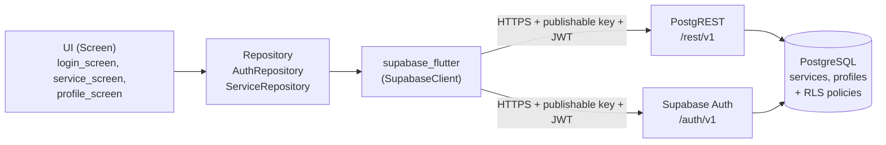

# Integrasi API Supabase — Layanan & Login

Dokumen ini menjelaskan semua perubahan yang membuat aplikasi YALT **memanggil API** (Supabase), dari awal sampai akhir. Bisa dipakai sebagai bahan presentasi.

---

## 1. Ringkasan: sebelum vs sesudah

| Bagian | Sebelum | Sesudah |
|---|---|---|
| Daftar layanan | Data dummy di `ServiceModel.dummyServices` | `GET /rest/v1/services` dari Supabase |
| Tambah / ubah / aktif-nonaktif layanan | Hanya berubah di memori HP, hilang saat app ditutup | `POST` / `PATCH /rest/v1/services`, tersimpan di database |
| Login | Mencocokkan nomor HP & password di `dummyCustomers` | Supabase Auth (`POST /auth/v1/token`) + baca tabel `profiles` |
| Logout | Kembali ke halaman login | Hapus sesi Supabase Auth, lalu kembali ke login |
| Ganti password | Mengubah field di objek dummy | Cek password lama ke server, simpan password baru via Supabase Auth |
| Hak akses admin | Hanya dicek di UI | Dicek di **database** dengan Row Level Security (RLS) |

> **Pembaruan 7 Nov 2026:** pesanan, pelanggan, timeline, QR, view, dan laporan sekarang juga memakai API. Data dummy sudah dihapus dari aplikasi. Detail database ada di [database.md](database.md), cara menjalankan dan menguji ada di [README](../README.md). Bagian di bawah ini adalah catatan tahap pertama (layanan & login).

---

## 2. Arsitektur



Pembagian tanggung jawab:
- **UI (screen)** hanya menampilkan data dan state (loading, error, kosong, sukses). UI tidak tahu soal URL atau SQL.
- **Repository** adalah satu-satunya tempat yang memanggil Supabase. Kalau backend diganti, cukup repository yang diubah.
- **Database** yang menentukan siapa boleh melakukan apa (RLS). Pengecekan di UI hanya untuk kenyamanan pengguna, bukan untuk keamanan.

---

## 3. Backend: Supabase (SQL)

Semua objek SQL disimpan sebagai *migration* di folder `supabase/` dan dijalankan di **SQL Editor** Supabase.

### 3.1 Migration 1: tabel `services`
File: `supabase/migrations/20261103000000_create_services.sql`

```sql
create table public.services (
  id uuid primary key default gen_random_uuid(),
  name text not null check (length(trim(name)) > 0),
  price_per_kg numeric(12, 2) not null check (price_per_kg > 0),
  is_active boolean not null default true,
  created_at timestamptz not null default now(),
  updated_at timestamptz not null default now()
);

create unique index services_name_unique_idx on public.services (lower(name));
```

Poin penting:
- `numeric(12, 2)` dipakai untuk uang, bukan `float`, supaya tidak ada error pembulatan.
- `check (price_per_kg > 0)` membuat database menolak tarif nol atau negatif, walaupun aplikasinya dibobol.
- Index unik `lower(name)` mencegah dua layanan bernama sama, misalnya "Cuci Kering" dan "cuci kering".
- Trigger `set_updated_at()` mengisi `updated_at` otomatis setiap kali data diubah.

RLS (Row Level Security) untuk membaca:
```sql
alter table public.services enable row level security;

create policy "Layanan dapat dibaca semua pengguna"
on public.services for select
to anon, authenticated
using (true);
```
Daftar layanan dan tarif adalah informasi publik, jadi boleh dibaca siapa saja.

### 3.2 Migration 2: tabel `profiles`, role, dan RLS admin
File: `supabase/migrations/20261103010000_create_profiles_and_service_admin_policies.sql`

**Tabel `profiles`** terhubung satu-satu dengan akun di `auth.users`:
```sql
create table public.profiles (
  id uuid primary key references auth.users (id) on delete cascade,
  full_name text not null check (length(trim(full_name)) >= 3),
  phone text not null unique check (phone ~ '^08[0-9]{8,11}$'),
  role text not null default 'customer' check (role in ('admin', 'customer')),
  ...
);
```

**Trigger `on_auth_user_created`**: setiap akun Auth baru dibuat, profilnya ikut dibuat otomatis.
```sql
case when new.raw_app_meta_data ->> 'app_role' = 'admin' then 'admin' else 'customer' end
```
Role diambil dari **app metadata**, bukan *user metadata*. App metadata hanya bisa diisi server/admin, jadi pengguna tidak bisa mengangkat dirinya sendiri menjadi admin.

**Fungsi `is_admin()`**, dipakai di semua kebijakan RLS khusus admin:
```sql
create or replace function public.is_admin()
returns boolean
language sql stable
security definer
set search_path = ''
as $$
  select exists (select 1 from public.profiles
                 where id = auth.uid() and role = 'admin');
$$;
```
- `auth.uid()` berisi id pengguna dari token login (JWT) yang dikirim aplikasi.
- `security definer` membuat fungsi ini boleh membaca `profiles` tanpa terhalang RLS. Tanpa ini, kebijakan RLS di `profiles` akan memanggil dirinya sendiri terus-menerus (rekursi).

**RLS tulis di `services`** (hanya admin):
```sql
create policy "Admin dapat menambah layanan"  on public.services for insert to authenticated with check (public.is_admin());
create policy "Admin dapat mengubah layanan"  on public.services for update to authenticated using (public.is_admin()) with check (public.is_admin());
create policy "Admin dapat menghapus layanan" on public.services for delete to authenticated using (public.is_admin());
```

**RLS `profiles`**: pengguna hanya bisa melihat profilnya sendiri, sedangkan admin bisa melihat semua profil.

### 3.3 Seed: data awal
File: `supabase/seed.sql`
- 4 layanan: Cuci Kering, Cuci Setrika, Setrika Saja, Cuci Kilat.
- 3 akun demo di `auth.users` + `auth.identities`. Password di-*hash* dengan `crypt(..., gen_salt('bf'))` (bcrypt):

| Akun | Nomor HP | Password | Role |
|---|---|---|---|
| Admin YALT | 081111111111 | ayamgoreng | admin |
| Prabowo | 081234567890 | ayamgoreng | customer |
| Jokowi | 089876543210 | ayamgoreng | customer |

Seed bisa dijalankan ulang tanpa data dobel (`on conflict do nothing`).

---

## 4. Konfigurasi Flutter

### 4.1 Paket
`pubspec.yaml` mendapat satu dependency baru: `supabase_flutter: ^2.18.3`.

### 4.2 URL dan key lewat `.env`
- `.env.example` berisi template yang di-commit, tanpa nilai rahasia.
- `.env` berisi nilai asli. File ini sudah masuk `.gitignore`, jadi tidak ikut ter-commit.
- Key yang dipakai adalah **publishable key** (`sb_publishable_...`). Key ini aman ada di aplikasi, karena keamanan sebenarnya dijaga RLS. **Secret / service_role key tidak pernah dipakai di aplikasi.**

`lib/config/env.dart` membaca nilainya saat build:
```dart
class Env {
  static const String supabaseUrl = String.fromEnvironment('SUPABASE_URL');
  static const String supabasePublishableKey = String.fromEnvironment('SUPABASE_PUBLISHABLE_KEY');
  static bool get isMissing => supabaseUrl.isEmpty || supabasePublishableKey.isEmpty;
}
```
Cara menjalankan app: `flutter run --dart-define-from-file=.env`. Argumen ini juga sudah dipasang di konfigurasi Run VS Code (`.vscode/launch.json`) dan Android Studio.

### 4.3 Inisialisasi di `lib/main.dart`
```dart
if (Env.isMissing) {
  runApp(const _MissingConfigApp()); // layar petunjuk, bukan crash
  return;
}
await Supabase.initialize(
  url: Env.supabaseUrl,
  publishableKey: Env.supabasePublishableKey,
);
```

### 4.4 Izin internet Android
`android/app/src/main/AndroidManifest.xml`:
```xml
<uses-permission android:name="android.permission.INTERNET"/>
```
Sebelumnya izin ini hanya ada di build *debug*. Tanpa baris ini, APK *release* untuk Play Store tidak bisa memanggil API sama sekali.

---

## 5. Lapisan Repository (pemanggil API)

### 5.1 `lib/repositories/service_repository.dart`

| Method | HTTP yang dikirim | Siapa yang boleh |
|---|---|---|
| `fetchServices()` | `GET /rest/v1/services?select=id,name,price_per_kg,is_active&order=name.asc` | Semua |
| `addService(name, price)` | `POST /rest/v1/services` | Admin |
| `updateService(id, name?, pricePerKG?, isActive?)` | `PATCH /rest/v1/services?id=eq.<id>` | Admin |

```dart
Future<ServiceModel> addService(String name, double pricePerKG) async {
  final row = await _client
      .from('services')
      .insert({'name': name, 'price_per_kg': pricePerKG})
      .select('id, name, price_per_kg, is_active')
      .single();
  return ServiceModel.fromJson(row);
}
```

`errorMessage()` mengubah kode error dari database menjadi pesan berbahasa Indonesia:

| Kode | Arti | Pesan ke pengguna |
|---|---|---|
| `23505` | Melanggar index unik | Nama layanan sudah dipakai |
| `23514` | Melanggar `check` | Data layanan tidak valid |
| `42501` | Insert ditolak RLS | Hanya admin yang dapat mengubah layanan |
| `PGRST116` | Update tidak mengenai baris apa pun (ditolak RLS) | Hanya admin yang dapat mengubah layanan |

`ServiceModel.fromJson` dan `toJson` sekarang memakai nama kolom database (`price_per_kg`, `is_active`).

### 5.2 `lib/repositories/auth_repository.dart`

| Method | Yang dilakukan |
|---|---|
| `signIn(phone, password)` | `POST /auth/v1/token?grant_type=password`, lalu `GET /rest/v1/profiles?id=eq.<uid>` untuk mengambil nama, nomor HP, dan role |
| `signOut()` | `POST /auth/v1/logout`. Kalau offline, cukup hapus sesi di perangkat |
| `changePassword(phone, old, new)` | Login ulang dengan password lama (verifikasi), lalu `PUT /auth/v1/user` dengan password baru |

Supabase Auth membutuhkan email, jadi nomor HP diubah menjadi **email internal**:
```dart
static String emailFromPhone(String phone) => '${phone.trim()}@yalt.test';
```
Pengguna tetap mengetik nomor HP. `.test` adalah domain khusus pengujian, jadi tidak pernah ada email yang benar-benar terkirim.

Error dari Auth diubah menjadi `AuthFailure` yang pesannya siap ditampilkan, misalnya "Nomor HP atau password salah" atau "Password lama salah".

`AuthRepository.instance` bisa diganti versi palsu saat tes (lihat bagian 7).

---

## 6. Perubahan di UI

### 6.1 `service_screen.dart` (Admin → tab Layanan)
- **Saat halaman dibuka**, data diambil dari API dan indikator loading tampil.
- **Kalau gagal** (misalnya offline), muncul ikon awan, pesan error, dan tombol **Coba Lagi**.
- **Kalau data kosong**, muncul pesan "Belum ada layanan."
- **Tarik layar ke bawah** (`RefreshIndicator`) untuk memuat ulang.
- **Tambah, ubah, dan aktif/nonaktif** dikirim ke API. Selama menyimpan, garis progres tampil di bawah AppBar dan tombol dinonaktifkan supaya tidak terkirim dua kali. Setelahnya muncul SnackBar hijau (berhasil) atau merah (gagal).
- Setelah berhasil, list diperbarui dengan **data balikan dari server**, bukan data ketikan pengguna. Dengan begitu, yang tampil pasti sama dengan isi database.

### 6.2 `login_screen.dart`
`AuthRepository.instance.signIn(...)` menggantikan pencarian di `dummyCustomers`. Validasi kolom kosong, tombol loading, dan banner error tetap sama seperti sebelumnya.

### 6.3 `admin_dashboard.dart` dan `customer_home_screen.dart`
Tombol **Keluar** sekarang memanggil `AuthRepository.instance.signOut()` sebelum kembali ke halaman login.

### 6.4 `profile_screen.dart` (Pelanggan → tab Profil)
Password lama sekarang dicek ke **server**, tidak lagi dibandingkan dengan data lokal. Kalau salah, pesan "Password lama salah" muncul di bawah kolom password lama. Kalau koneksi gagal, muncul SnackBar merah.

---

## 7. Pengujian

### 7.1 Analisis kode
`flutter analyze` → **No issues found**.

### 7.2 Tes widget (`test/widget_test.dart`): 7 tes, semua lulus
Tes widget tidak boleh bergantung pada internet, jadi:
- Supabase diinisialisasi dengan URL palsu (`http://localhost`).
- `AuthRepository.instance` diganti dengan `_FakeAuthRepository` yang mencocokkan akun di `dummyCustomers`.

Tes ganti password disesuaikan, karena pengecekan "password lama salah" sekarang terjadi setelah form valid (dicek ke server).

### 7.3 Tes integrasi ke Supabase sungguhan (`test/service_repository_test.dart`): 4 tes, semua lulus
```
flutter test test/service_repository_test.dart --dart-define-from-file=.env
```

| Tes | Hasil yang diharapkan | Status |
|---|---|---|
| Ambil daftar layanan | List tidak kosong, semua tarif > 0 | ✅ |
| Tanpa login menambah layanan | Ditolak RLS, kode `42501` | ✅ |
| Pelanggan menambah / mengubah layanan | Insert `42501`, update `PGRST116` | ✅ |
| Admin menambah, mengubah, menonaktifkan | Berhasil, data tes dihapus lagi | ✅ |

### 7.4 Tes manual API
```
GET <SUPABASE_URL>/rest/v1/services?select=name,price_per_kg,is_active
apikey: <publishable key>
```
Hasil: **HTTP 200**, 4 layanan. Di app versi web, request yang sama juga terlihat saat tab Layanan dibuka.

---

## 8. Alur demo untuk presentasi

1. Buka **Supabase → Table Editor → services**, tunjukkan isi tabelnya.
2. Jalankan app, lalu login sebagai **admin** (081111111111 / ayamgoreng).
3. Buka tab **Layanan**: data yang tampil sama dengan isi tabel.
4. **Tambah layanan** (misalnya "Cuci Bedcover", Rp 15.000), lalu refresh Table Editor: barisnya muncul.
5. **Ubah tarif langsung di Table Editor**, lalu tarik layar di app: tarif ikut berubah.
6. **Nonaktifkan** salah satu layanan: kolom `is_active` di tabel menjadi `false`.
7. Coba tambah nama yang sudah ada: muncul pesan "Nama layanan sudah dipakai" dari database.
8. Logout, lalu login sebagai **pelanggan** (081234567890): bukti role dibaca dari tabel `profiles`.
9. Bukti keamanan: jalankan tes integrasi (bagian 7.3), atau kirim `POST /rest/v1/services` tanpa login di Bruno. Hasilnya ditolak `42501`.

### Pertanyaan yang mungkin ditanyakan dosen

- **"Key-nya ada di aplikasi, apa tidak bahaya?"**
  Itu *publishable key*, yang memang dirancang untuk aplikasi klien. Siapa pun yang memegang key ini tetap dibatasi RLS. Key berbahaya (*secret / service_role*) tidak pernah dipakai di aplikasi.
- **"Bagaimana kalau orang memanggil API langsung, tidak lewat aplikasi?"**
  Tetap ditolak. Aturan "hanya admin" ada di database (RLS), bukan di Flutter. Tes integrasi membuktikannya.
- **"Kenapa login pakai email kalau yang diketik nomor HP?"**
  Login nomor HP di Supabase butuh layanan SMS berbayar. Jadi nomor HP dipetakan ke email internal `<nomor>@yalt.test`, dan pengguna tetap mengetik nomor HP.
- **"Kenapa tarif pakai `numeric`, bukan `double`?"**
  `double` bisa menghasilkan error pembulatan, contohnya 0.1 + 0.2 ≠ 0.3. Untuk uang harus angka desimal yang pasti.
- **"Kenapa layanan dinonaktifkan, bukan dihapus?"**
  Supaya riwayat pesanan yang memakai layanan itu tetap utuh.

---

## 9. Keterbatasan saat ini

Sudah diselesaikan pada 7 Nov 2026:
- ~~Pelanggan yang ditambahkan admin belum bisa login~~. Sekarang dibuat lewat RPC `admin_create_customer` (akun login + profil). Sejak 18 Nov 2026 password awal wajib diisi admin, tidak ada password bawaan.
- ~~Pesanan, timeline, dan QR masih dummy~~. Sekarang memakai RPC `sp_create_order`, `sp_update_order_status`, `sp_get_pickup_token`, `sp_pickup_order`, ditambah Realtime.
- ~~Kasir POS & beranda pelanggan membaca list layanan bersama~~. Sekarang setiap halaman mengambil data layanan sendiri dari API.

Yang masih tersisa:
- **Sesi login tidak diingat**: setiap app dibuka ulang, pengguna harus login lagi.
- "ID Pelanggan" di tab Profil tampil sebagai UUID yang panjang.
- Pendaftaran akun publik sebaiknya dimatikan di **Authentication → Sign In / Providers → Allow new users to sign up**.

---

## 10. Daftar file

**Baru**
| File | Isi |
|---|---|
| `supabase/migrations/20261103000000_create_services.sql` | Tabel `services`, trigger `updated_at`, RLS baca |
| `supabase/migrations/20261103010000_create_profiles_and_service_admin_policies.sql` | Tabel `profiles`, trigger akun baru, `is_admin()`, RLS admin |
| `supabase/seed.sql` | 4 layanan + 3 akun demo |
| `.env.example` | Template konfigurasi Supabase |
| `lib/config/env.dart` | Membaca URL & key dari `--dart-define-from-file` |
| `lib/repositories/service_repository.dart` | API layanan (GET, POST, PATCH) |
| `lib/repositories/auth_repository.dart` | Login, logout, ganti password, baca profil |
| `test/service_repository_test.dart` | Tes integrasi ke Supabase + bukti RLS |
| `.vscode/launch.json` | Konfigurasi Run VS Code dengan `.env` |
| `docs/integrasi-api-supabase.md` | Dokumen ini |

**Diubah**
| File | Perubahan |
|---|---|
| `pubspec.yaml` / `pubspec.lock` | Tambah `supabase_flutter` |
| `lib/main.dart` | Inisialisasi Supabase + layar petunjuk jika `.env` kosong |
| `lib/models/service_model.dart` | `fromJson` / `toJson` memakai nama kolom database |
| `lib/screens/admin/service_screen.dart` | Ambil & simpan via API, state loading / error / kosong / refresh |
| `lib/screens/login_screen.dart` | Login via Supabase Auth |
| `lib/screens/admin/admin_dashboard.dart` | Logout menghapus sesi Supabase |
| `lib/screens/customer/customer_home_screen.dart` | Logout menghapus sesi Supabase |
| `lib/screens/customer/profile_screen.dart` | Ganti password via Supabase Auth |
| `android/app/src/main/AndroidManifest.xml` | Izin `INTERNET` untuk build release |
| `android/gradle.properties` | `kotlin.incremental=false` (masalah build proyek di drive G: dengan pub cache di C:) |
| `test/widget_test.dart` | Supabase palsu + `_FakeAuthRepository` |
